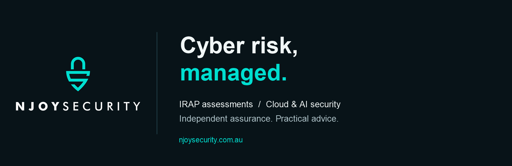

  

  <strong>Independent cyber security assurance.</strong> 
  Working across Australia and the World.

  <a href="https://www.njoysecurity.com.au/">Website</a> &nbsp;·&nbsp;
  <a href="https://www.njoysecurity.com.au/irap-assessments.html">IRAP assessments</a> &nbsp;·&nbsp;
  <a href="https://www.linkedin.com/company/njoy-security">LinkedIn</a> &nbsp;·&nbsp;
  <a href="mailto:contact@njoysecurity.com.au">Contact</a>

---

### Assurance that supports confident decisions

NJOY SECURITY is a boutique Australian cybersecurity consultancy supporting government, Defence and technology providers. We turn complex security requirements into clear findings and practical next steps.

| Expertise | How we help |
| --- | --- |
| **IRAP assessments** | Independent assessments against the Australian Government Information Security Manual, with clear reporting and findings. |
| **Cloud & AI security** | Reviews of architecture, controls and security risks across cloud platforms and AI services. |
| **Cyber risk & architecture** | Practical advice on security design, governance and risk treatment. |
| **Policies & procedures** | Clear security documentation, including policy and procedure support for ISO 27001. |

### Talk to NJOY SECURITY

Discuss an assessment, cloud or AI review, or a cyber risk challenge.

**[Start a conversation →](https://www.njoysecurity.com.au/#contact)**  
[contact@njoysecurity.com.au](mailto:contact@njoysecurity.com.au)

NJOY SECURITY · Compliance Corp Pty Ltd
